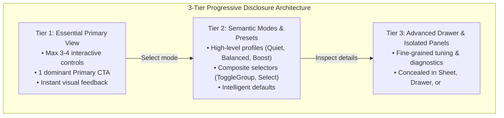
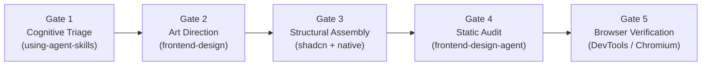

# Progressive WebUI Workflow

A battle-tested, 5-stage sequential engineering workflow that prevents cognitive overload and eliminates AI-generated UI clichés. It combines cognitive ergonomics (Hick's Law), Anthropic aesthetic restraint, robust component composition (shadcn/ui and native HTML5/CSS primitives), and Vercel's comprehensive interface guidelines.

---

## 1. The Core Problem: Backend Variable Dumping

When language models build user interfaces, they instinctively map backend data structures directly to screen elements. Every database column, API parameter, numerical multiplier, and configuration flag is exposed as an input field or slider on the main page.

### The Consequences
- **Cognitive Paralysis (Hick's Law):** Decision time increases logarithmically with choice count ($T = b \cdot \log_2(n + 1)$). A screen with 15 simultaneous controls repels non-expert users.
- **Fragmented Visual Hierarchy:** Without clear primary and secondary pathways, users cannot discern what is essential versus incidental.
- **AI Design Clichés:** Interfaces fall back on generic templates (cream backgrounds, uniform SaaS cards, tracked ALL-CAPS subtitles, and raw technical jargon).

### The Solution: 3-Tier Progressive Disclosure Architecture



---

## 2. The 5-Gate Sequential Workflow



---

### Gate 1: Cognitive Triage & Progressive Disclosure Matrix

**Tools / Skills:** `using-agent-skills` (`interview-me`, `spec-driven-development`).

Before writing a single line of UI code, inventory all variables, actions, and settings required by the backend and classify them into the **Triage Matrix**.

#### Mandatory Triage Table Template

| Parameter / Action | Primary User Need | Assigned Tier | Target UI Control | Justification |
| :--- | :--- | :--- | :--- | :--- |
| Core Query / Input | Primary task execution | **Tier 1** | Text Input + Search CTA | 95% of sessions start here. |
| Operational Profile | Select workload intensity | **Tier 2** | `ToggleGroup` (Eco / Fast) | Abstracts 6 backend variables. |
| Timeout / Concurrency | System tuning | **Tier 3** | Number input in `<Sheet>` | Only 5% of power users adjust this. |
| Internal Telemetry Token | Auth & background state | **Internal** | None (auto-configured) | Zero user benefit to expose. |

#### Invariants of Gate 1
- **Tier 1 Hard Limit:** Exactly 1 primary CTA and $\le 4$ visible interactive elements.
- **No Raw Hyperparameters:** Zero numeric weights, multipliers, or timeouts in Tier 1.

---

### Gate 2: 2-Pass Art Direction & Human Language

**Tools / Skills:** `frontend-design`.

Execute art direction in two disciplined passes to ensure visual distinction and human-centered copy.

#### Pass 2.1: Design Plan & ASCII Wireframing
- **Semantic Palette:** Define 4 to 6 hex tokens grounded in the domain (not generic grey/blue).
  - `--background`: Canvas floor.
  - `--foreground`: Primary text/ink.
  - `--primary`: Dominant accent / CTA.
  - `--secondary` & `--muted`: Quiet structural grounding.
- **Typographic Scale:** Set distinct display and body faces; line lengths strictly $< 80$ characters; `text-wrap: balance` on headings.
- **ASCII Wireframe:** Sketch the spatial relationship between Tier 1, Tier 2, and the Tier 3 trigger:

```text
+-----------------------------------------------------------+
| Brand Logo / Context                              Theme   |
+-----------------------------------------------------------+
|                                                           |
|   Headline in Domain Voice (text-wrap: balance)           |
|                                                           |
|   [ Tier 1: Primary Input Field                     ]     |
|   [ Mode: (Quiet) | [Balanced] | (Turbo) ]  (Tier 2)     |
|                                                           |
|   [==== EXECUTE PRIMARY TASK (Primary CTA) ====]         |
|                                                           |
|   Ajustes avanzados y diagnóstico… (Tier 3 Trigger)       |
+-----------------------------------------------------------+
```

#### Pass 2.2: AI-Cliché & Copywriting Review
1. **Purge AI Tells:**
   - Reject default warm cream backgrounds (`#F4F1EA`) with terracotta buttons.
   - Reject uniform rounded cards (`rounded-2xl` with identical grey shadows).
   - Reject tracked-out `ALL-CAPS` eyebrow tags above every title.
   - Reject highlighting a single word in italic or color in headings.
2. **Transform Copy:**
   - Rewrite system jargon into active voice from the user's perspective.
   - *"Guardar cambios"* instead of *"Submit"*.
   - *"Historial de sesiones"* instead of *"DB Cache query response"*.
   - Provide constructive error messages with actionable next steps.

---

### Gate 3: Structural Assembly with Accessible Primitives

**Tools / Skills:** `shadcn` (or Native HTML5/CSS), `frontend-ui-engineering`.

Assemble the interface using standard component primitives that guarantee keyboard navigation and semantic structure.

#### Stack Mapping Matrix

| Layer | React / Next.js / Vite (shadcn/ui + Tailwind) | Lightweight / Python (Vanilla, FastHTML, Gradio) |
| :--- | :--- | :--- |
| **Tier 1 Form** | `<FieldGroup>`, `<Field>`, `<FieldLabel>`, `<Input>` | `<form class="flex flex-col gap-4">` + `<label>` |
| **Tier 1 Action** | `<Button variant="default">` + `<Spinner data-icon>` | `<button type="submit" class="btn-primary">` |
| **Tier 2 Selector** | `<ToggleGroup spacing={2}>` or `<Select>` | `<div role="radiogroup">` or native `<select>` |
| **Tier 3 Isolation** | `<Sheet>` (side drawer) or `<Accordion>` | Native `<dialog>` modal or `<details><summary>` |
| **Status Feedback**| `<Alert variant="default">`, Sonner `<Toaster>` | `<div role="alert">`, CSS toast notification |
| **Loading Placeholders** | `<Skeleton className="h-4 w-3/4" />` | `<div class="skeleton-shimmer">` |
| **Empty States** | `<Empty><EmptyTitle>...` | Empty container with clear CTA to create/start |

#### Critical Rules for Gate 3
1. **Forms:** Never raw `div` with `space-y-*`; use `FieldGroup` + `Field` and `gap-*`.
2. **Overlay Titles:** Every `<SheetContent>`, `<DialogContent>`, or `<dialog>` MUST have an accessible title.
3. **Icons in Controls:** Use `data-icon="inline-start"` on SVG icons inside buttons; never add manual `size-4` or `w-4 h-4`.
4. **Zero Manual z-Index:** Let overlay primitives manage their own stacking context.

---

### Gate 4: Static Audit of >100 Rules

**Tools / Skills:** `frontend-design-agent`, `web-interface-guidelines`.

Run a comprehensive audit using `frontend-design-agent` to check compliance across interactions, animations, accessibility, and performance.

#### Core Verification Checklist
- [ ] **Ergonomics:** Tier 1 controls count $\le 4$ + 1 CTA.
- [ ] **Keyboard:** Visible focus rings (`:focus-visible`; `:focus-within`), no `outline: none`.
- [ ] **Touch Targets:** Minimum $24\text{px}$ (mobile $44\text{px}$); input font size $\ge 16\text{px}$.
- [ ] **Paste Protected:** No blocking paste (`onPaste` with `preventDefault`).
- [ ] **Animations:** Honoring `prefers-reduced-motion`; animating only `transform` and `opacity`; no `transition: all`.
- [ ] **Typography:** True ellipsis character `…` used; curly quotes “ ”; numeric comparisons use `font-variant-numeric: tabular-nums`.
- [ ] **Layout:** Respects `env(safe-area-inset-*)`; no horizontal page scroll (`overflow-x: hidden`).
- [ ] **Modals & Drawers:** `overscroll-behavior: contain` applied.

---

### Gate 5: Visual & Interactive Browser Verification

**Tools / Skills:** `browser-testing-with-devtools`, `/browser`.

Inspect the compiled application running in a real Chromium browser instance before declaring the task complete.

#### Step-by-Step Verification Protocol
1. **Responsive Viewport Test:**
   - Test at **320px** (small mobile), **768px** (tablet), **1024px** (laptop), and **1440px** (desktop).
   - Evaluate in console: `document.documentElement.scrollWidth <= window.innerWidth` (must be `true`).
2. **Interactive Drawer Test:**
   - Click the Tier 3 trigger (*"Ajustes avanzados…"*) and confirm the drawer/dialog animates smoothly without layout shift.
   - Press `Escape` and verify focus returns cleanly to the trigger.
3. **Contrast & Dark Mode Test:**
   - Verify text contrast meets APCA / WCAG 2 AAA standards.
   - Toggle dark mode: ensure background, cards, and input borders invert correctly with zero low-contrast text.

---

## 3. Definition of Done (DoD) Checklist

A user interface is **Production-Ready** when:
- [x] **Triage Matrix Documented:** Every backend variable is accounted for in Tier 1, 2, or 3.
- [x] **Tier 1 Clean:** No more than 4 controls and 1 CTA visible on initial render.
- [x] **Domain Identity:** Custom 4–6 hex token palette; zero AI design tells.
- [x] **Accessible Primitives:** Forms use `FieldGroup`/semantic fields; overlays have titles.
- [x] **Vercel Guidelines Clean:** 0 violations for focus, touch target, reduced-motion, and tabular-nums.
- [x] **Browser Verified:** Tested in real Chromium viewport with zero horizontal overflow.
